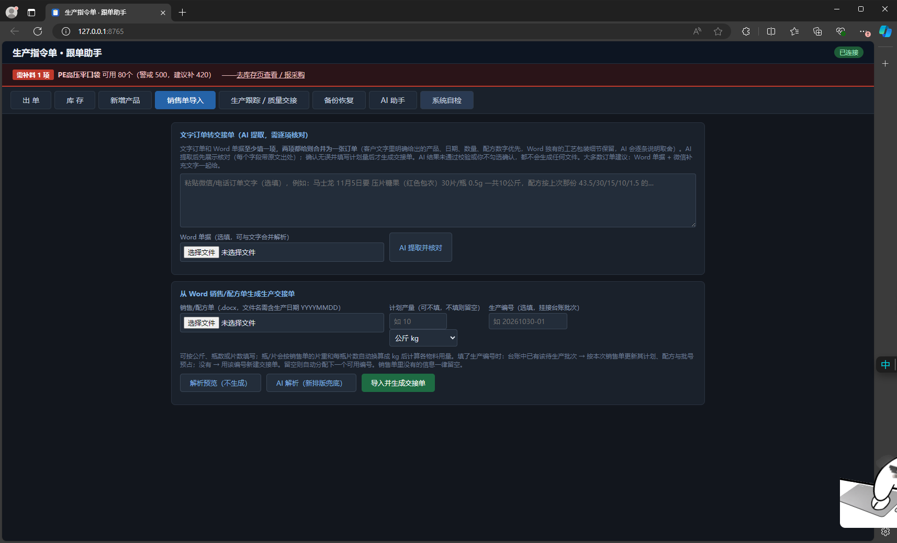
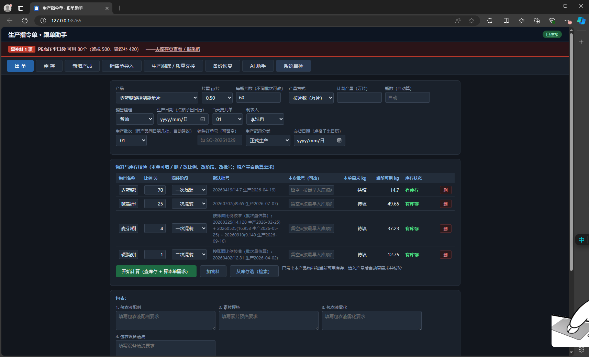

# 生产指令单系统 OrderSystem

**把食品厂的「接单 → 生产指令单 → 跟单 → 库存」全流程搬进电脑。**
销售单（Word / 微信文字）由 AI 提取、人工把关，3 分钟生成四段式生产交接单，批次自动入台账，物料自动按 FIFO 扣减。


---

## 🧡 本项目由 95算力 赞助

[](https://95znai.com)

**赞助商：[95算力](https://95znai.com)** —— 本项目的 AI 能力（销售单解析、台账问答、每日简报）由 95算力 提供算力支持，并给予长期赞助。

> 📢 **95算力 开发者赞助计划**
> 用 95算力 做插件、软件、短视频等作品，发布到 GitHub 等平台并注明「由 95算力 赞助」，即可领取 10 积分起的奖励，上不封顶。Star 越多奖励越高，优秀项目可获得长期赞助。作品链接请发给客服微信 **Ohhhhhh0908**。

⭐ 如果这个项目帮你省下了手工抄单的时间，点个 Star 就是对赞助商和我们最大的支持。

---

## 这是什么

一套已经在食品厂**真实生产线投产**的生产指令单 / 跟单系统。它不是 Demo，是每天在用的工具：

```
销售单（Word 单据 / 微信聊天记录 / 口头报单文字）
        ↓  AI 自动提取产品、规格、数量、配方、交期
        ↓  人工逐项核对（AI 只提取，绝不擅自生成文件）
四段式生产交接单（Excel，单号自动编号归档）
        ↓  台账自动登记，批次自动入账
跟单跟踪（工序记录 / 质量交接 / 交期提醒 / 缺料预警）
        ↓  FIFO 批次扣减 + 库存预占
库存与采购预测（含柠檬云 ERP 导出对账自动修正，可回滚）
        ↓
每日 18:00 自动备份 + 季度恢复演练（备份真的能用）
```

### 核心能力

| 模块 | 能解决什么问题 |
|------|----------------|
| 📥 **销售单导入** | Word 单据、纯文字、微信聊天记录混合解析；客户文字里的日期/数量/配方优先，Word 里的工艺包装细节保留；AI 提取结果逐字标红出处，不确认就不生成任何文件 |
| 🏭 **生产指令单** | 四段式交接单自动生成 Excel，按配方比例自动算物料需求、推荐批次、实时校验库存；正式生产 / 测试 / 实验三类分开管理，测试实验单可彻底删除 |
| 📋 **跟单台账** | 手动新增跟踪单；订单到了产品还没建档？可当场录产品全名、片重、配方，同步建配方并参与库存预占 |
| 📦 **库存管理** | FIFO 批次分配、待生产库存预占、采购缺口预测；与柠檬云 ERP 每日对账，差异自动修正且全程留痕可回滚 |
| 📦 **包装与工序** | 包衣液配制 / 素片预热 / 包衣雾化 / 设备清洗分段填写，工序与质量交接全程可追溯 |
| 🤖 **AI 助手** | 中文直接问台账（"今天有哪些单要盯？哪些料不够？"），首页自动生成 AI 今日简报 |
| 🔒 **安全红线** | AI 只读 + 提取，写操作必须人工勾选；库存自动修正仅限编码精确匹配；所有改动可从备份回滚 |
| 🛠 **无人值守** | Windows 计划任务 5 件套：登录自启 / 5 分钟心跳自愈 / 每日备份 / 季度恢复演练 / 柠檬云定时同步 |

## 界面预览

**销售单导入 · AI 提取并逐项核对**（文字订单与 Word 单据可合并解析，未确认不生成文件）



**出单 · 物料与库存校验**（按配方自动算需求、推荐批次、实时校验库存，包衣工序分段填写）



## 技术栈

- **Python 3.8+**，依赖仅 `openpyxl` / `python-docx` / `xlrd` / `bottle` / `Eel`
- 内置 `libs/xlrd` 备份，内网/弱网环境也能跑
- Web UI 部署在 `webui/`，本地 HTTP 服务默认 `http://127.0.0.1:8765`，浏览器打开即用，无需安装客户端
- 运维脚本：PowerShell + VBS，一条命令注册 5 个 Windows 计划任务
- 数据落地为本地 JSON + Excel，不依赖数据库，方便备份、迁移和审计

## 快速开始

```bash
# 1. 克隆
git clone https://github.com/wuxibao53-cloud/OrderSystem.git
cd OrderSystem

# 2. 装依赖
pip install -r requirements.txt

# 3. 注册定时任务（管理员 PowerShell，可选）
powershell -ExecutionPolicy Bypass -File maintenance\install_tasks.ps1

# 4. 启动，浏览器打开 http://127.0.0.1:8765
启动系统.bat
```

> 换电脑 / 首次安装详见 [`README_交接与安装.md`](README_交接与安装.md)、[`换电脑安装说明.md`](换电脑安装说明.md)、[`全量备份与安装交接说明.md`](全量备份与安装交接说明.md)。

## 目录结构

```
OrderSystem/
├── app_gui.py           # 桌面 GUI 主程序
├── api_server.py        # 本地 HTTP API（8765）
├── orders.py            # 订单 / 跟单台账
├── stock.py             # 库存 / 批次 / 采购预测
├── generator.py         # 生产交接单 Excel 生成
├── sales_form_import.py # 销售单 / 微信记录解析导入
├── lemon_sync.py        # 柠檬云库存对账同步
├── ai_agent.py          # AI 台账问答 / 每日简报
├── maintenance/         # 计划任务 / 健康检查 / 备份恢复
├── tests/               # 单元测试（64 项）
├── images/              # 文档配图
└── webui/               # Web 前端
```

## 安全与隐私

- 本仓库**不含任何真实业务数据**：订单、库存、配方、客户信息、AI 密钥均已通过 `.gitignore` 排除
- 密钥需在本地 `data/ai_config.json` 自行配置，永不上传
- 所有 AI 只做「读取 + 提取」，任何写文件 / 改台账都要人工确认
- 数据每日自动备份并做恢复演练，误操作可从快照回滚

## 赞助与致谢

本项目由 [95算力](https://95znai.com) 赞助开发，感谢长期算力支持 ❤️
使用 95算力 的 AI 能力完成了销售单智能解析、台账问答与每日简报三大模块。

## License

[MIT](LICENSE)
